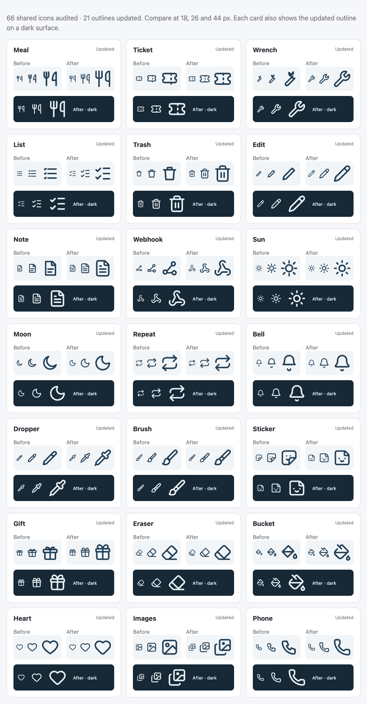

# Interface icons

Use the shared inline SVG components in `web/src/icons.tsx` for interface controls.
They use a 24 × 24 canvas, a two-unit outline, rounded ends and joins, and the
surrounding text color. Their default display size is 26 px; callers may override
size, class and style. Icons are decorative and unfocusable by default. Put the
visible name or accessible label on the enclosing button or link.

The November 2026 audit covered all 66 shared icons, standalone SVGs in the web
app, and the public app icon. It corrected 21 outlines: meals, tickets, upkeep,
lists, trash, edit, notes, webhooks, sun, moon, repeat, notifications, dropper,
brush, stickers, gifts, eraser, paint bucket, heart, images and phone. The fixes
remove overlapping strokes, align folds and arrowheads, and give small details
more room. Existing components apply these fixes wherever each icon is used.

The corrected outlines come from [Lucide](https://lucide.dev), revision
`c55aab36b553a7de50a0050e7042fd7b2d64664e`, with the license retained in
`web/src/icons-LICENSE`. They are copied inline; there is no runtime icon package.
Keep that license when copying more outlines.

The brand mark, QR code, charts, progress rings and drag grips have their own
purposes and geometry. Family-selected emoji, notification kind emoji, and emoji
in demo content remain emoji. They are not malformed interface SVGs.

When changing an outline, compare it at 18, 26 and 44 px on light and dark
surfaces, then check it in the demo at phone, tablet and wall sizes, including
phone landscape. Keep its familiar meaning. Run `node --test test/icons.test.ts`
from `web/` to check rendering and the shared accessibility and sizing contract.

## Outline comparison

The updated outlines at 18, 26 and 44 px, with their previous versions alongside:

