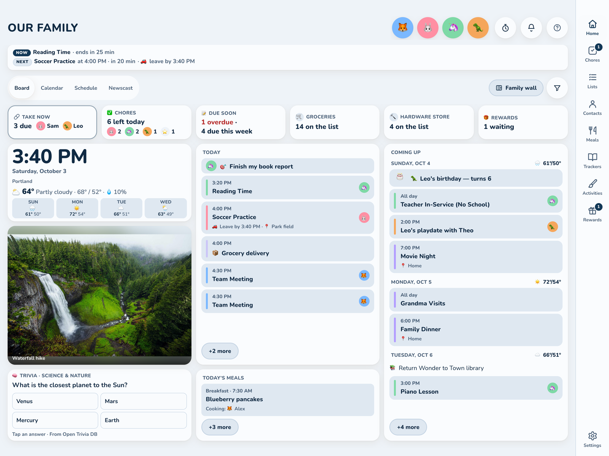
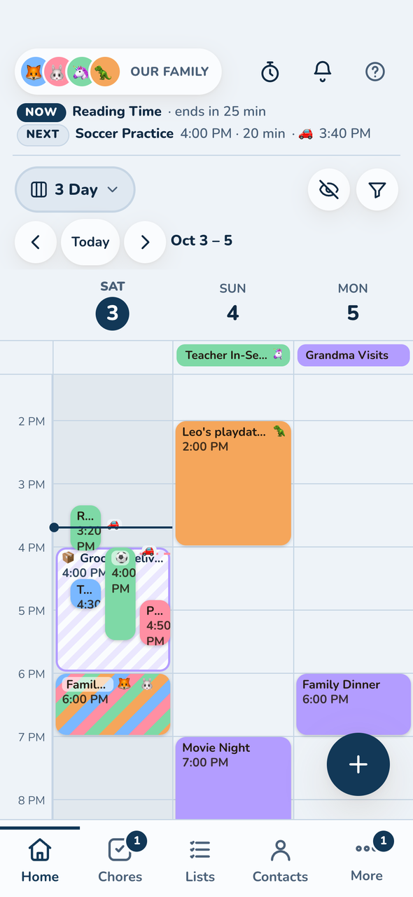
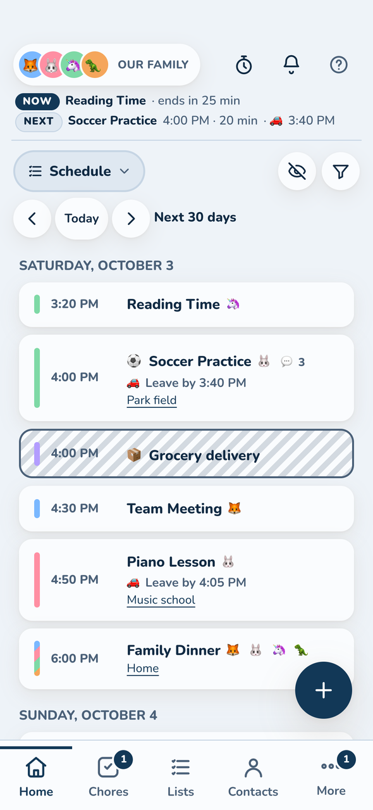
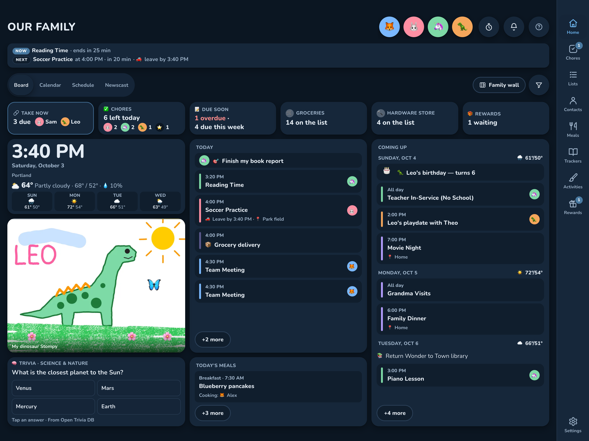
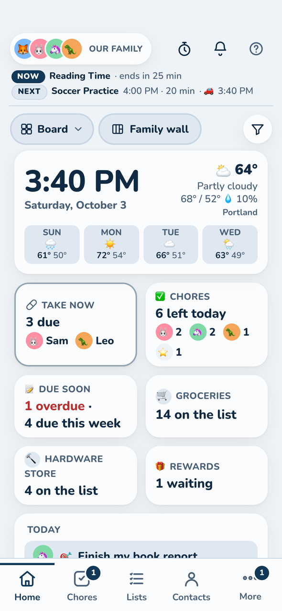
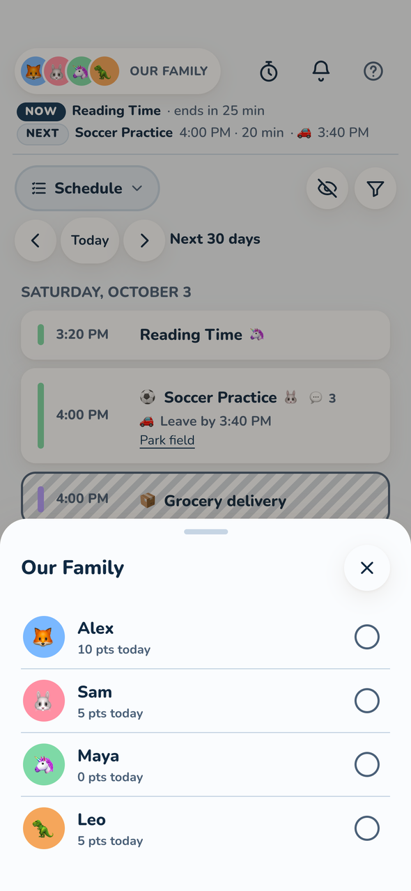

# Home & calendar

**Home** is the main screen, first in the navigation (the 🏠 house): the Board and Newscast. **Calendar** is second (the 📅 page): Day, Week, Month and Schedule. Both merge every enabled calendar. Each event is colored by its [category](categories.md), or by its family member if it has no category.

**Spaces:** Meals, Outings, Trackers and Activities are Kinwall's spaces, areas of their own with several parts inside. It's only a heading (Settings → Features, the phone's More list); each tab keeps its own name.

**New events** go on the family's default calendar unless you pick another in the event sheet: a parent sets it in [Settings → Calendars](../settings/calendars.md#calendars), and until then it's the family's own Kinwall calendar rather than an imported one (a school feed or a meal kit's deliveries). See [Events](events.md#creating-and-editing).

**A calendar that stops syncing:** on a parent's device, Home and Calendar show a warning at the top ("⚠️ The Work calendar isn't syncing") when a connected calendar has failed to sync twice in a row (one blip doesn't count), or an imported one still needs reconnecting. **Repair the connection** opens Settings → Calendars, where the calendar shows what went wrong. The warning goes away once it syncs again. Wall screens and kids' devices don't show it.

## Views

Home has two tabs at the top: **Board** and **Newscast**. **Newscast** (and with it the tabs) goes when the family turns it off in [Features](../settings/general.md#features).

Calendar has four: **Day**, **Week** (**3 Day** on a phone), **Month** and **Schedule**. It opens the view you used last on that device; the first time, that's **Week** on a tablet or wall screen and **Schedule** on a phone. With big text, or on a phone as narrow as 320 pixels, the four don't fit in a row, so one button shows the current view (like **3 Day ⌄**) and opens a sheet of all four, with a line on what each shows.

| View | Shows | Paging (◀ ▶ or swipe) |
|---|---|---|
| **Board** | A family bulletin board for today and the week ahead. See [Board view](#board-view). | None: always today onward |
| **Day** | One time grid for the whole family's day. Events at the same time sit side by side, each shows once with the avatars of who it's for, and [free](events.md#free-or-busy) events sit behind the busy ones, striped and marked "Free". See [One event, shown once](#one-event-shown-once). | ±1 day |
| **Week** (iPad / desktop) | 7 day columns with an all-day row and a time grid. The week starts on Sunday or Monday, per [General](../settings/general.md). | ±1 week |
| **3 Day** (phones) | The same grid, 3 days from the anchor date. | ±3 days |
| **Month** | A month grid with event chips. When a day is full, it shows "+N more". | ±1 month |
| **Schedule** | An agenda of the next 30 days, grouped by day. Location lines link to maps. | ±30 days |
| **Newscast** | What the family did and shared: chores done, rewards, photos, books and announcements, with reactions. See [Newscast](newscast.md). | None: the last 7 days, then **Earlier this month** |

The Day, Week and 3 Day grids open at 7 AM, or on today an hour before now (with now always on screen). A screen 1280 pixels wide or more, and a [cast screen](../settings/this-display.md), shrinks the hour rows so 7 AM to 9 PM fits without scrolling, as far as it can while staying readable. An event too short for two lines shows its time after its title ("Team Meeting · 4:30 PM"), and the line for now runs under the events, marked by a dot at the left edge.

Every device opens Home on **Board**. A display can be locked to any view (Settings → General → This screen → [Lock view](../settings/this-display.md#this-screen)), which hides the tabs: locked to Board or Newscast, it has no Calendar button; locked to Day, Week, Month or Schedule, Calendar takes Home's place in the navigation and is where the screen goes back to when idle.

Links: `#/home` opens Home, `#/calendar` opens Calendar in its last view, and `#/calendar/day`, `/week`, `/month` or `/schedule` open that view.

  
  

### Meals on the calendar

A [meal's calendar event](meals.md#the-calendar) has 🍽️ before its title, so it reads as a meal in every view. Once the meal is **Cooked** (or **Ordered**, when eating out) it gets a ✓ as well:

* **Month** cells and all-day chips show just 🍽️✓.
* **Week**, **3 Day** and **Day** put "✓ Cooked" or "✓ Ordered" after the time. A meal still to come shows nothing extra.
* **Day** also shows how an order night is going ("6:00 PM · 3 of 4 orders in") until it's ordered.
* **Schedule** adds a small tag: **✓ Cooked**, **✓ Ordered**, **Planned**, or an order night's "3 of 4 orders in".
* The event's page shows the same tag under its time; an order night's page shows its orders instead.

Screen readers hear it too ("meal: Cooked").

### One event, shown once

In every view, an event shared by several people shows once, with each person's avatar on it. The same event can also come in from two connected calendars (say a meeting on both the family calendar and a work calendar). Kinwall treats two events as the same when they're on different calendars and have the same title (ignoring capitals and extra spaces), start, end and all-day setting. They show as one, with everyone from both, and tapping it opens the first one. Two events with the same title and time on one calendar stay separate, so each can still be opened and changed. If one copy was renamed, both show.

## Board view

The board carries its own large clock and date, so while it's showing, the wall's header hides its clock and keeps only the family name, avatars and buttons.

**Board** turns the calendar into a bulletin board to read from across the room. It always shows today onward, so it has no ◀ ▶ or swipe paging.

Across the top, count tiles sum things up; tap one to open its screen (on a phone they come after the clock, and on a tablet too narrow for one row they take two even rows):

* **Groceries**: how many items are still on your [Groceries lists](lists.md#list-types). Hidden if you have none.
* **Shopping**: the same for your Shopping lists (the hardware store and the like). Only while one of them has something on it.
* **Rewards**: reward requests waiting for a parent's OK. Hidden when there are none.

With one list of a type, its tile shows the list's emoji and name and opens it; with several, it opens the Lists page.

With only one or two of these tiles, they don't take a whole row: they sit on the Board's toolbar as buttons beside **Polls**, **Outings** and **Layout and filter** (**🛒 Groceries 1**, **🔨 Hardware store 4**), and the cards move up. When the toolbar is too tight for their names, each shows just its emoji and count, and when even that doesn't fit (a phone on its side with large text), **Polls** and **Outings** show just their icons too. A tablet standing up gives them a row under the toolbar; a phone on its side keeps them on the toolbar's row. Three or more stay a row of tiles, and so do they on a phone, whose toolbar has no room.

Things about today follow right after today's events in the **Today** card (any spare room is at the bottom of the card), in this order:

* **💊 Take now**: medicine doses due now, with who; tap it to mark them in a sheet. Only while a dose is due, with [medication reminders](medications.md) on.
* **✅ Chores**: how many of today's chores are left, with each person's avatar and count (a ✓ once they're done), or **All done ✓**. Tap it to go to Chores. Not with **Full lists**, where Chores today is its own card.
* **📝 Due today**: to-dos due today and overdue ones (in red), and how many more are due later this week. Tap it to go to Lists, for the whole week. Not with **Full lists**, where Due soon is its own card.
* **🗳 An open [family poll](polls.md)**: the question, its choices with who voted, and "3 of 4 voted". Tap it to vote.

Today's events come first. Each of these shows whole when the card has room left under the events, and as one row ("🗳 Where are we eating Friday? · 3 of 4 voted") when it doesn't; on a phone or a board that scrolls they're always one row. They're always there, never cut off: when today is busy, the events show what fits and **+3 more** opens the rest. Today always keeps at least one of its events (two when there's room) with **+N more**: when the rows would crowd them out (a tablet on its side), these share small buttons that say what they count (**💊 3 to take**, **✅ 7 chores**, **📝 1 to-do due**, **🗳 3 of 4 voted**), on two lines if that still leaves Today one of its events, else one line of just the counts (💊 3, ✅ 7, 📝 1, 🗳 3/4); if even that's too tight the card grows. Phones never need these: their Today card grows instead. On a [layout](#board-layouts) without Today, Take now, Chores and Due soon stay tiles across the top, and a poll moves under the events in **Coming up** (or a slim strip above the cards without that either). A layout with the tiles row turned off leaves Take now, Chores and Due soon off, but still shows a poll in Today.

Below them are the cards:

* **Clock**: a big clock and the date, with the weather now, today's high and low, and the next 4 days. On a phone today's weather sits beside the time, so the card stays short. The clock never gets cut off: the other cards give it the room, and a shorter screen (under 900 pixels tall, like a tablet on its side) leaves out the next 4 days. The weather needs a weather location in [General settings](../settings/general.md).
* **Today**: everyone's events for today, with times or "All day", a bar in each member's color and their avatars. An event with a category shows its emoji (⚽ Soccer Practice), so it matches Calendar, where the category's color fills it. Birthdays 🎂 come first, then what's on now (and all-day events), then what's coming up later today. Events that have finished fold into one row at the bottom, like **3 events earlier today ›**; tap it to see them, faded, in a sheet. So late in the day the card shows what's left, not what's over. Above them, 🎯 today's goals from [Temp check](snapshot.md#temp-check), for people who chose to show theirs (on a display pinned to one person, only theirs).
* **Coming up**: the next 6 days, grouped by day, with each day's weather and birthdays. Where the add button covers the bottom of the card, events stop above it and **+N more** sits beside it.
* **Due soon** (full lists only): open list items due in the next week, overdue ones first in red, plus urgent and important items with no date. Each shows its list's emoji and the owner's avatar.
* **Chores today** (full lists only): a bar per member showing how many of today's chores are left.
* **Today's meals**: today's [meals](meals.md) in the order they happen (a 3:30 snack before a 6:00 dinner), with times and who's cooking. The next one is marked. Tap one to open it right on the Board: a recipe meal shows its recipe (with **Start cooking**), and **Edit meal** (parents) or **Meal details** (the cook's notes and status) is a tap away; dining out and other meals open the meal's sheet. With no meals planned, tapping the card goes to Meals to plan one.
* **Get stuff done** (in a [layout](#board-layouts) only): a checklist's progress, for example "🌙 Bedtime · 3 of 8" with a bar. Tap it to open the list in [Get stuff done](lists.md#get-stuff-done). It shows the list picked in the layout editor, or the first reusable list, and is hidden with Lists turned off.
* **Picture**: a new picture every minute, from the same sources as this display's [screensaver](night.md#screensaver): drawings (with their names), [family photos](photos.md) (with their captions, along the bottom in up to two lines), art (with the painting's title and artist) or nature photos. With no screensaver pictures chosen, it shows your family photos, or nature photos until you've added some.
* **Quote or fact**: a short quote, a fact marked **💡 Did you know?**, a neurodivergent-friendly tip marked **🌱 Try this**, and, if the family turned them on, something from [Wikipedia](https://www.wikipedia.org)'s **On this day** or a **trivia question** with multiple choice (tap a choice to guess, and **Try again** to reset it). It changes every 30 minutes, taking turns through the sources that are on. Every display on the family's choice shows the same one at the same time. Choose the sources and categories in [Settings → Quotes & facts](../settings/general.md#quotes--facts). A screen can pick its own instead, and show up to 3 cards, each with its own sources and a title saying what it shows (like **Trivia**, **Tips** or **On this day**), under [Settings → This screen → Board quotes & facts](../settings/this-display.md#this-screen). On the wall a second card sits under Coming up and a third shares the picture's column, and each shows what fits with **+N more** for the rest (one too small for its first line keeps its title above **+1 more**) (a trivia card always keeps its answers on the card and scrolls if it has to, so you answer right there); two columns put them side by side; a phone shows the first card. A short screen (a tablet on its side, or a [cast screen](../settings/this-display.md)) leaves the quote card out so **Today** gets its whole column: the picture becomes a strip with **Today's meals** under it.

Tap an event to open it, an item to open its list, or a chore bar to go to Chores. The member and category filters apply to the board's events too, and the member filter to its chores, to-dos and reward requests: a kid's device, or a display pinned to one person, counts only their chores (plus **Anyone**'s, unless the display hides shared ones), like the Chores tab, their to-dos (assigned to them or on their lists, plus unassigned ones on family lists, which the same setting hides) and their own reward requests. The board refreshes every 10 minutes and whenever something changes. With low-stimulation mode or reduced motion on, the picture and quote change without fading, and in low-stimulation mode the quote cards change once an hour instead of every half hour.

On a wall display or tablet the cards fill the screen in three columns without scrolling. A 10" tablet on its side gets them too; a shorter screen (under 640 pixels tall, like a small laptop window) shows two columns that scroll instead. A card shows what fits; when there's more, a **+3 more** button at the bottom opens the whole card in a sheet, right on the Board (Today's meals says **4 meals** when none of them fit). **Board chores & to-dos** in [This screen](../settings/this-display.md) picks **Counts** (just the tiles), **Full lists** (the Chores today and Due soon cards instead of their tiles) or **Auto** (the default: full lists only on a big screen, at least 1600 × 900 pixels of board, and counts otherwise). On phones they stack in one column, with a smaller picture.

### Finish setting up Kinwall

On a parent's phone or computer, the top of the Board lists what's still missing after setup, each row opening the right spot in Settings:

* **📆 Connect a calendar**: no calendars yet. Opens Settings → Calendars.
* **🖼️ Put Kinwall on the wall**: no wall screen or kid's device paired yet. Opens the **Add a wall screen or kid's device** sheet.
* **👪 Add your family**: only one person in the family. Opens Settings → Family → Members.
* **🔑 Add a second way in**: one passkey and no unused recovery codes. Opens Settings → Access → Recovery codes.

Each row goes once it's done, and the card goes when none are left. **Not now** hides it on that device for 30 days. Wall screens and kids' devices never show it.

### Board layouts

Each screen can arrange its own Board. Under [Settings → This screen → Board layout](../settings/this-display.md#this-screen), pick a built-in layout (**Kids** with big text, **Kitchen** with meals up front, **Parents** with more on the screen, **Simple** with just the clock, a picture and today), one of the family's [presets](../settings/general.md#board-presets), or **Own layout** to make one just for this screen.

To switch quickly, tap **Layout and filter** (the sliders at the end of Home's toolbar). Its **Layout on this screen** chips list the same layouts, with a line under them on the one picked, and the Board changes behind the sheet as you tap. **Own layout…** opens the editor the first time; once this screen has one, **Edit this screen's layout** shows. **Manage layouts** goes to Settings (to **Board presets** on a parent device, to **Board layout** under This screen otherwise). Under the layouts are the [categories](#filtering-by-category). On a screen locked under **Lock view**, the button is just the category filter, so a locked wall stays as set.

The layout editor shows the Board as columns of cards (1 to 4 columns, up to 6 cards in each):

* **Drag** a card by its grip to another place or column, or use its arrows: **↑ ↓** within the column, **← →** to the next column.
* **Height**: **Short**, **Medium** or **Tall**, its share of the column.
* **Text size**: **Big text** to read from across the room, **Normal**, or **Small text** to fit more rows.
* **Get stuff done** card: which list it shows, a to-do or reusable list; **First reusable list** is the default.
* **✕** takes a card off; **Add a card** puts it back. **Count tiles across the top** turns the tiles row on or off; in a layout, the Chores and Due soon tiles show only when their full cards aren't on the Board.
* **Start from** replaces the layout with the family wall layout, a built-in one or a family preset, to change from there.

A card for something the family turned off (like Meals) stays hidden, and so does a quote card with nothing to show. When that empties a column, the others widen, but a layout of two or more columns never shrinks to one: what's left splits into two columns. Phones and narrow screens show the layout's cards in one or two columns, in order, column by column.

To keep a display on the board, set **Lock view** to **Board** in [This screen](../settings/this-display.md).

## The header

On a wall display or a tablet on its side, the header shows the family name, the time and date, everyone's avatars, the [notification bell](notifications.md#notification-feed) and **Help**.

On a phone, or a tablet standing up (portrait), the header is one row:

* The **family button** on the left: a pile of faces and the family name. Tap it to open the family sheet. See [On a phone](#on-a-phone).
* The **bell** and **Help** on the right.

There's no clock in this header, since the phone or tablet already shows the time.

**Help** (the **?** button) is in the same spot on every screen. It opens a short sheet with **Help with this page** (the docs page for the screen that's open, or the Settings tab you're on), links to these docs, accessibility notes, **Report a problem** and **Suggest a feature** (short GitHub forms; a problem report arrives with the Kinwall version filled in), plus the Kinwall version.

The browser tab or window title shows the screen and your family name, for example "Chores · Our Family".

### Now / Next

A strip above the calendar shows what's on now and what's next today, with a countdown and any 🚗 leave-by time. It shows on every view. Events shown as [free](events.md#free-or-busy), like a delivery window, are left out, so a 12-hour window never sits there as "Now" all day. On a cast screen, Now and Next share one line when they fit.

* On a wall display it hides when nothing is left today.
* On a phone it's always two lines, so the screen never jumps. When the day is done it reads "Nothing more today".
* On a phone on its side it shows on the Board only, leaving the calendar and schedule the height.

You can turn it off per device under [Time cues](../settings/this-display.md#time-cues).

## Navigating

* **◀ / ▶** or **swipe** left and right to page. The new period slides in from the side you swiped toward.
* **Today** jumps back to the current date.
* Tap a **day header** (Week) or a **day cell** (Month) to open that day in Day view.
* On a phone, a Month day is too small to aim at one event, so tapping anywhere in it (its events too) opens that day in Day view, where every event is big enough to tap. **Month** in the view tabs goes back to the month (with big text, a **‹ Month** button beside the view button does, or **‹ 3 Day** when you came from 3 Day). On tablets and wall screens, tapping an event in Month still opens it, and the rest of the day (or "+N more") opens the day.
* A day you open this way doesn't change which view **Calendar** opens next time. Leaving Calendar forgets it: you come back to today in the last view you picked.
* Tap an **empty slot** in the time grid to add an event at that time, or tap the **+** button. **+** adds to the day you're looking at: in Day view, that day; in Week, 3 Day and Month, today if it's on screen, else the first day shown; on the Board, today. On today it starts at the next half hour, on another day at 9 AM. On the Board, the cards keep their rows out from under **+** (what would sit there moves into **+N more**), and a Board that scrolls leaves room to scroll past it. Newscast has no **+**.
* Tap an **event** to open its detail sheet. See [Events](events.md).
* Keyboard: arrow keys move between day headers, and Enter opens the day.
* After 2 minutes idle, a wall screen or kid's device goes back to Home, on the Board (or to Calendar on today, on a display locked to a calendar view) and closes any open sheet, except while an activity, [Get stuff done](lists.md#get-stuff-done), [cooking mode](meals.md#start-cooking) or [shopping mode](lists.md#shopping-mode) is open. Parents' phones and computers don't, unless you turn on **Back to Home when idle** on that device ([Settings → General → This screen](../settings/this-display.md#this-screen)). It can be turned off on a wall screen the same way.

## Filters

### By family member

Tap a member's avatar in the header to open [their snapshot](snapshot.md). Its **Show only …** button at the top shows only their things across Kinwall: events, chores, lists and the rest; the other avatars dim. Tap **Show everyone** to clear the filter. While someone is picked, a **Showing only Maya ✕** button sits under the toolbar on Home and Calendar, so it's clear why the others' events are gone; tap it to show everyone again. (A display pinned to one person doesn't show it.)

While the filter is on, every view shows only that person's events, on the same grid. An event they share with others still shows everyone's avatars. The filter also applies to the Board and the Chores tab.

On a wall screen, picking someone also says who's using it. Until the screen goes idle (2 minutes without a tap) or reloads, whatever needs a name is done as them, without asking "Who?": ticking off an **Anyone** chore, voting in a poll, marking interest in an outing, reacting to or sharing on the Family wall, suggesting a chore, playing an activity, starting a drawing and adding a note. The message that confirms it names them ("Done! ✓ Maya", with **Undo**), and polls and outings say "Voting as Maya" or "Marking for Maya". When the picked person can't do something (a grown-up suggesting a kid's chore), it asks as usual. With nobody picked, the wall asks every time. When the screen goes idle the pick clears, so the next person starts fresh. Picking someone only says who's doing things: it never shows their private things, like health or a grown-up's own notes. Phones, computers and screens pinned to one person keep their pick.

#### On a phone

Tap the family button at the top left. The family sheet lists everyone, with how many points they've earned today.

* **Tap a person** to open [their day](snapshot.md), where you can also tick off their chores.
* **Only** on the right shows only them: its circle fills in, the row says "Showing only them", and their face moves to the front of the pile on the family button. Tap it again to show the whole family.

On phones, Home's toolbar is one row: **Board | Newscast**, then **Polls** and **Outings** (each icon with its name in small letters under it, or just the icon at a larger text size) and **Layout and filter**. Calendar's is two: **Day | 3 Day | Month | Schedule** across the first, then ◀ **Today** ▶, the dates shown, **Show hidden** and the filter. (With big text the view button takes the first row, beside **Show hidden** and the filter.)

### By category

When any categories exist, a **filter** button (the funnel) appears in Calendar's toolbar. It's named **Filter and sort** and opens the **Filter and sort** sheet with the categories. On Home, the categories are in **Layout and filter** (the sliders), under the layouts:

* Pick one or more categories. **No category** matches events without one.
* With nothing picked, every event shows. **Show all** clears the selection.
* A badge on the button shows how many categories are picked.
* The filter is saved **per device**, one for Home and Calendar together. A wall display can hide work events for good, on the Board and the calendar alike, while phones still see everything.
* Categories deleted since you picked them are ignored, so a stale filter can't hide everything.

The member and category filters combine, and every view honors both. To hide events for the whole family instead, see [Calendar filters](#calendar-filters) and [Hiding events](#hiding-events).

## Calendar filters

A calendar can show the family only some of its events. The school's calendar, for example, can keep just the days off and half days and leave out every book fair and spirit day. A filter is set per calendar for the whole household, from a parent's device: open **Settings → Calendars**, tap the calendar, then **Filter**. Wall screens and kids' devices can't change it. (To hide a category on one device only, use the [category filter](#by-category) above.)

* **Show**: **All events** (no filter), **Only events that match**, or **All except events that match**.
* **Words in the title**: words or phrases, separated by commas. They match whole words in any case, like [category keywords](categories.md): "break" matches "Winter Break – No School" but not "Breakfast with the Principal". An event matches with any one of them.
* **All-day or timed**: **Either**, **All-day only** or **Timed only**.
* **Categories**: optional. When you pick some, an event matches only with one of them.

An event matches when it fits every choice you made: one of the words, and all-day (if you picked that), and one of the categories (if you picked any). A filter with no words, categories or all-day choice does nothing.

**Start from a preset** fills everything in, and you can change it after:

| Preset | Shows | Words |
|---|---|---|
| **School: days off & half days** | Only matching all-day events | no school, closed, day off, vacation, break, holiday, recess, half day, early release, early dismissal, professional development, PD day, teacher workshop, in-service, snow day, conferences, and US holidays like Labor Day and Thanksgiving |
| **Holidays only** | Only matching events | holiday, and holidays like Thanksgiving, Christmas, Hanukkah, Diwali and Lunar New Year |
| **Hide birthdays** | All except matching | birthday, bday, b-day |

While you edit, the sheet previews the next 3 months: "Showing 14 of 212 events in the next 3 months", with the shown and hidden events listed, soonest first. **Save** applies it right away.

A filtered-out event is gone everywhere the family sees events: every calendar view, the Board, Now / Next, [reminders, transition warnings and leave-by pushes](notifications.md), Live Activities, the daily summary, [snapshots](snapshot.md) and [connected apps](../integrations/mcp.md). Nothing is deleted: Kinwall still syncs every event and decides what to show when it reads them, so changing a filter needs no resync and hidden events come back as soon as you change it.

## Hiding events

A parent can hide one event from the whole family, even one that comes from a read-only calendar like a school feed. Open the event, then **Hide…** at the bottom of its sheet (parents' devices only; wall screens and kids' devices don't have it):

* **Hide this event**, or for a recurring event **Just this one** or **Every one in the series**. Occurrences a synced series adds later are hidden too.
* **Hide events like this**: adds the event's title to the calendar's [filter](#calendar-filters) as an exception ("All except events that match"), after asking. Every event with those words in its title stays hidden, including new ones. When the calendar shows **Only events that match**, a word can't hide more, so the sheet says to change the filter in Settings instead.

Hidden events are gone everywhere a filtered-out event is (see above), a wall screen or kid's device can't open one from a task linked to it or read its discussion either, and they stay hidden after every sync: Kinwall remembers them by the provider's own ids, like the members and categories you set on synced events.

To bring one back:

* **Settings → Calendars**, tap the calendar, then **Hidden events**: each one hidden (or each series, "Every one in the series") with **Show again**.
* Or on the calendar, tap the **eye** button at the end of the toolbar, next to the filter (parents' devices, every view but the Board). Hidden and filtered-out events then show faded, with a dashed border and an eye-slash and "Hidden" before the title, so they never rely on color. Open one for **Show again**, or, for one the filter leaves out, a link to change the filter. Tap the eye again to hide them.

## How events are colored

* **Category set**: the category color, with the category emoji before the title. Member avatars still show.
* **One member**: that member's color.
* **Two or more members**: diagonal stripes in each member's color, with their avatars.
* **No member**: the calendar's color.

Who an event is for never depends on telling colors apart: the avatars always show too.

## Opening from a notification

Tapping a reminder notification (or **View** in the bell) opens `#/calendar?event=<id>&at=<start>`: Calendar, on that day in its last view (Month switches to Schedule), with the event open. Close it and you're looking at the event's day.

`#/home?checkin=<member id>` opens that person's day at their check-in, and `#/home?poll=<id>` (a new poll in the bell) opens that poll. See [Daily check-in](snapshot.md#daily-check-in).
