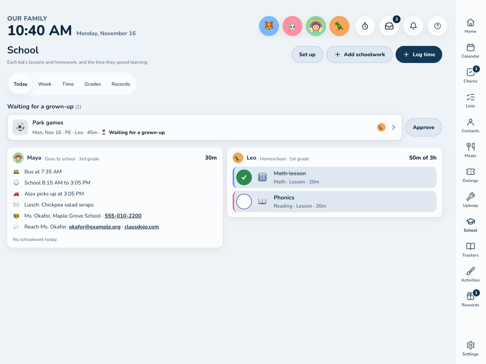
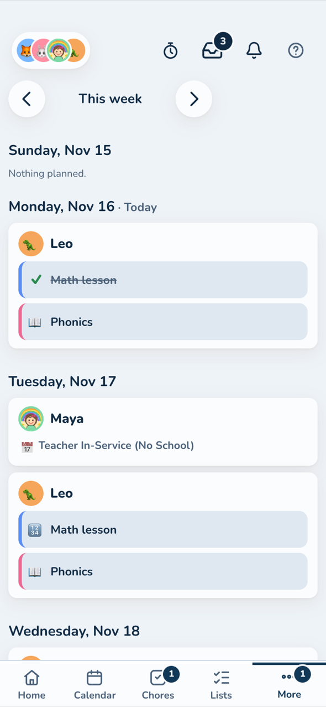

# School

**School** keeps track of what each kid learns, by subject: lessons at home, homework, reading practice, a museum visit. It works for kids who are homeschooled and for kids who go to a public or private school, side by side in the same family.

Look for the graduation cap in navigation to open **School**.

School starts off. Turning it off hides schoolwork from Chores, the Board, reminders and routine mode, and stops schoolwork ticks. Saved schoolwork and records stay and come back when you turn it on again. Turn it on in [Settings → General → Features](../settings/general.md#features) (**School**, under Nooks).

## Set up

A parent taps **Set up**. Each kid's settings fold away under their name, with a line saying how they're set up ("Goes to school · 3rd grade · Maple Grove School"); tap a kid to open them.

* **Kids**: for each kid, pick **Homeschooled**, **Goes to a school** or **Not in school**, and their grade if you like. Only kids in school show in School. Grown-ups never do.
* **A grown-up checks the time Maya logs** (with each kid’s name): time that kid logs from a wall screen or their own device waits for a parent to approve it, and doesn't count until then. Grown-ups get a notification ("Maya logged 30 min of Science. Approve?") in the bell and on their phones. Time a parent logs never waits.
* **For a kid who goes to a school**: when school starts and ends, the **school days**, how many **report cards a year** (terms) the school gives (lowering it hides the later terms' grades and report card photos, after asking; they're kept and come back if you raise it again), and how they get there and home: **Getting to school** and **Getting home** are each the bus or a grown-up (who drops off or picks up), with a time. **Early release ends** is when a half day ends, with the bus or pickup home on those days (**Early release bus** or **Early release pickup**).
* **School year starts**: the day each kid's school year begins (mid-August, August 15, unless you change it; set it to your school's first day). Records and grades count a school year from that day to the day before it comes round again.
* **School calendars**: any calendars you already have in Kinwall, like the feeds the school and the district publish ([add one](../calendars/ics-feeds.md)) or your own school calendar. Pick as many as you need. Their events show on that kid's School day and on their row in **Week**, and they say which days are [days off and early release](#days-off-and-early-release).
* **Last day of school** (optional): leave it empty to use a "Last Day of School" event on the calendars. After it, it's summer: no schoolwork and no bus reminders until the next school year starts. Until then, Today counts down ("148 school days left").
* **Which school**: the school, from [Contacts](contacts.md), right under each kid's grade. Not there yet? Tap **New school…** at the top of the list (type its name in the search first to carry it over) and fill in the contact form; the new school is picked once you add it. Its number is the one to call. Kids at the same school share its schedule: the school hours, early release, school days, school calendars, school year, last day and report cards a year, and, for those who ride the bus, the bus times. Change any of them on one kid's card and the others change too; a kid who joins the school (or starts riding its bus) takes what the others have. A grown-up's drop-off or pickup stays each kid's own, so one can ride the bus while another is picked up.
* **Teacher**: their teacher's name. It shows with the school and the school's number ("Ms. Okafor, Maple Grove School · 555-010-2200"), since teachers rarely have a number of their own. Add the teacher's **email** and **another way to reach them** (a ClassDojo, Seesaw or Remind link) and Today shows those too, on grown-ups' phones and computers only, never on the wall or a kid's device.
* **Other contacts**: a tutor, a coach or a carpool, from Contacts (or **New contact…** to add one). A wall screen shows only what Contacts lets it show.
* **Goals for a homeschooled kid**: hours a year, school days a year and minutes a day. Leave any of them empty for no goal. Today shows the day's time against the daily goal ("50m of 3h"), and Records shows the year's.
* **Subjects**: Math, Reading, Writing, Science, History, Art, Music and PE to start. Rename them, change a color or emoji, give one a goal of hours a year (**h/yr**), add your own ("Latin") or put one away. A subject that's put away keeps its name on the time logged under it. Deleting a subject leaves that time with no subject.

## Today and Week

**Today** shows each kid's school day: for a kid who goes to a school, on school days the bus or who drops off and picks up ("🚌 Bus at 7:35 AM", "🚗 Alex picks up at 3:05 PM") and the school hours, and any day the school calendar's events and the day's lunch from [Meals](meals.md); for any kid, their teacher and school with its number, and other contacts. On a day off or a half day it says so first ("🏖️ No school · Thanksgiving Recess", "⏰ Early release"), and on a half day the times are the early release ones. Then their schoolwork for today with a tick beside each, and how much school time they've logged so far. 

**Week** lays the week out by kid and day, with each kid's days off and early release and their school calendar events at the top of the day. On a phone it's a list, day by day. On a wall or a kid's device, tapping something in Week ticks it; on a parent's device it opens it to change.

## Schoolwork

A parent taps **Add schoolwork** for a lesson, homework, a test or a project:

* **What**, its **subject** and **kind**, and **who it's for** (one kid or several: each gets their own to tick).
* **Repeat**: the same choices as a chore, from **Once** (homework due Friday) to **Weekly** on school days (a new lesson starts on Monday to Friday), **Custom…** (every 2 weeks, monthly, ending on a day or after a number of times) and **A few times a week or month…**.
* **School time it counts for**: ticking it off logs this much time under its subject. Undoing the tick takes it back. Changing who completed it moves the time to that kid and follows their approval settings.
* **Points**: 0 to start. With points it counts toward rewards like any chore.
* **More options**: a start time, a timer and whether a tick needs a parent's OK, as on a chore.
* **Free time**: with [routine mode](routine-mode.md) on, schoolwork holds a kid's free time like any chore until it's ticked off: all of today's schoolwork when free time waits for every chore, or just the homework you pick as a required chore. Skipped schoolwork on a day with no school doesn't hold it.
* **Still due on days off**: off to start, so it's skipped on a kid's days with no school (a holiday, a break, summer). Turn it on for homework over a break.

Schoolwork is a chore with a subject. It's added in School and can be ticked off in either **School** or **Chores**. On Chores, its category is **Schoolwork**, and a backpack badge names its kind (**Homework**, **Lesson**, **Test** or **Project**), including in **To approve**. Editing schoolwork from Chores opens the School editor, with its subject and school time. On the Board's **Today** card it has a line of its own under the events ("🎒 Schoolwork · 2 left today", with each kid and how many they have left) that opens School, and schoolwork with a start time or a timer gets a row among the day's events, like a chore. It never shows as a late chore on the Board. Time from a tick on a wall or a kid's own device waits for a grown-up when that kid's School settings say so. When the tick itself needs a parent's OK, its time is logged once a parent approves it.

## Days off and early release

School reads each kid's school calendars for days off, half days and the last day of school. An event whose title holds words from the family's list makes the days it covers:

* **No school**: "No School", "Holiday", "Recess", "Break" (Winter Break, not Breakfast), "Vacation", "In-Service", "Teacher Workday" and a few more.
* **Early release**: "Early Release", "Early Dismissal", "Half Day" (also written "1/2 Day" or "½ Day"), "Noon Dismissal".
* **Last day of school**: "Last Day of School", "Last Day for Students".

Words match whole words in any case. Change the list in **Set up → Days off and early release**: tap words to remove them, or add your own ("Snow Day"). On a day with no school, schoolwork is skipped (unless it's [still due on days off](#schoolwork)) and so are bus and pickup reminders. A half day uses the early release times.

An early release match wins over a no-school match on the same day, including matches from different school calendars. For example, "Holiday Recess Begins - 1/2 Day" and "1/2 Day - Professional Development In-Service" are half days. A parent's choice for that day still wins over the calendars.

For a snow day, a make-up day or an early release the calendars don't have, a parent taps **Change today** on Today, or a day in **Week** (**Change day** on a phone), and picks **School day**, **Early release** or **No school** for each kid. **As the calendars say** goes back to the calendars.

## Bus and pickup reminders

On a school day or half day, School reminds before the bus comes and drops off, and before a grown-up's drop-off or pickup:

* **Before the bus**: 10 minutes to start. Kids on the same bus at the same time get one reminder ("🚌 Bus at 7:35 AM: Time to get Maya and Leo to the bus stop."). It goes to the bell, grown-ups' phones and those kids' own devices.
* **Before a drop-off or pickup**: 15 minutes to start ("School pickup at 3:05 PM: Pick up Maya from school."), to the grown-up doing it, on their own phone (every grown-up's when they haven't set one as theirs).

Change either, or turn one off, in **Set up → Bus and pickup reminders**. Each device can turn them off under **School reminders** in [notifications](notifications.md). On an iPhone with the Kinwall app and the leave-by Live Activity on, the reminder also starts a countdown on the Lock Screen: 🚌 with the kids and "Bus at 8:30 AM", or 🚗 for a drop-off or pickup. Days off, weekends and summer have none, and a half day uses the early release times (with none set, there's no reminder home that day).

## Grades

The **Grades** tab is for grown-ups and appears once a kid goes to a school. Pick the school year (search for an older year if you need it), then type each grade in its subject and term: `A-`, `3`, `92%` or `Meets` all work. A grade saves when you leave its box; clearing the box removes it.

Grades never show on a wall screen or a kid's own device, and the server refuses them there too. **Share term 1 on Newscast…** writes a post with that term's grades for you to change, and you choose whether grown-ups or everyone sees it. That's the only way a grade leaves the Grades tab.

## Records

The **Records** tab is for grown-ups. Pick a school year; each kid's runs from their **School year starts** day. For each kid it shows:

* **Hours** and **days** so far, against their goals. A day counts as a school day when there's approved time logged for it.
* Each subject's time, against its goal when it has one.
* Month by month: school days and time.
* The **portfolio**: every photo added to logged time.
* **Report cards**, for a kid who goes to a school: a photo for each term (**Add a photo**).

Grades and Records refresh when another device changes school data. You can pick any school year back to 2000.

**Print report** prints that kid's year on its own, for a year-end report or your state's records. Time waiting for a grown-up isn't counted until it's approved.

## Log time

Tap **Log time**, pick a subject, tap every kid who took part, set how long, and save. You can also add what you did ("Fractions with pizza slices") and notes, add a **photo** (it goes in the portfolio, not the family photos) and pick an earlier day.

One save for several kids adds the time to each kid's total, and shows once in the list with everyone's faces. A parent taps an entry to change it for everyone on it, or to delete it.

Who can log:

* **A parent's phone or computer**: any kid in school.
* **A wall screen**: any kid in school.
* **A kid's own device**: only that kid.

## The week

School opens on this week (it starts on your family's first day of the week). Each kid's card shows their total and a bar split by subject, with each subject's time written out under it. Below that, what was logged, newest day first. The arrows go back a week at a time.

On a parent's device, **Waiting for a grown-up** at the top lists time kids logged that needs a yes. **Approve** counts it. To turn it down, open it and delete it.

**Download all school time (CSV)** saves every entry, one row per kid, for a spreadsheet or your state's records.

## When a kid is removed

Removing a kid from the family keeps their school records: logged time, grades and report card photos stay, under their name ("Leo (removed)" on the Time tab and in the CSV), and they're in the export.

## Assistants and other apps

School has REST routes under `/api/school` ([REST API](../integrations/rest-api.md)), the webhook `school.changed` ([Webhooks](../integrations/webhooks.md)), the chore fields `schoolSubjectId`, `schoolKind`, `schoolMinutes` and `schoolDaysOff`, each kid's days from `GET /api/school/days` and a parent's mark for one with `PUT /api/school/days/{memberId}/{date}`, the day rules and reminder times in the setting `school`, `create_chore` with `subject` and `schoolKind` ("Maya has a spelling test Friday"), `GET`/`PUT /api/school/grades`, `GET /api/school/records` and `PUT /api/school/report-cards` (parents only), and the MCP tools `get_school_grades` ("what did Maya get in math?"), `log_school` ("log 45 minutes of science for Maya and Leo") and `get_school_summary` ("how much math did Leo do this month?") ([MCP](../integrations/mcp.md)). Subjects, kids, every entry, the grades, report cards and marked days are in the [export](../your-data/export-import.md).
