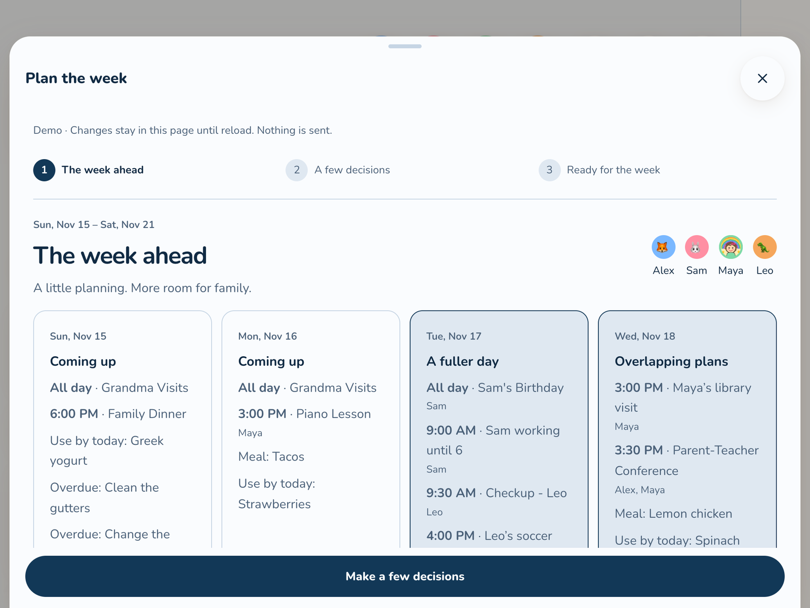
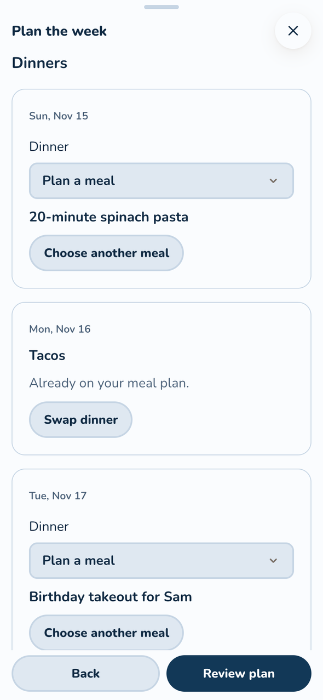
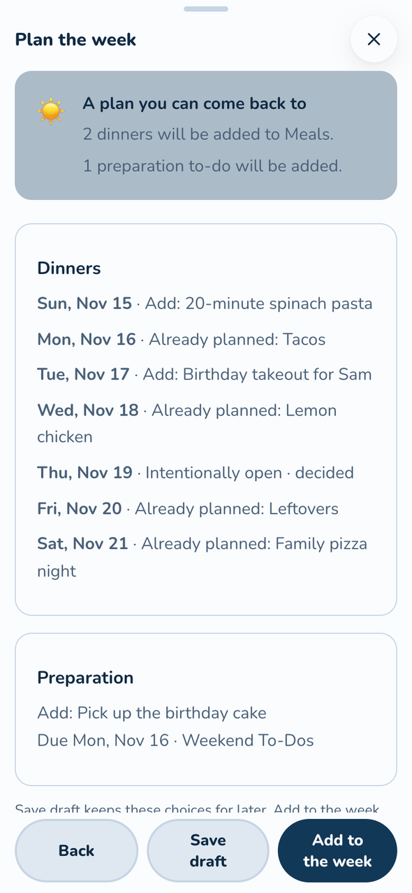

# Plan the week

Parents can open **Plan the week** from the Calendar toolbar or **A look at next week** on
Home. It starts with the next complete week, using the family's week-start setting and
timezone. It is part of Calendar, with no new navigation tab or feature switch.

Hide **A look at next week** on Home with its **×** button. **For how long?** offers **Today**, **This week** or **Until I show it again**. The choice is remembered on this device, even after reloading. Today expires at the family’s midnight; this week expires at the next family week-start day. **Undo** brings it straight back. **Plan the week** stays available on Calendar; open it and choose **Show planner on Home** to restore the Home prompt later.

## Look over the week

The overview brings together visible calendar events, meals, due to-dos, food to use and
home upkeep. Overlapping timed events are flagged when they involve the same person or
a shared family commitment. That is a prompt to look closer, not a pickup assignment or
a claim that anyone is available. Hidden events stay hidden. Meals, Lists and Upkeep
appear only while their existing features are on. Private health trackers, medications,
journals and check-ins are not read by planning.

## Make a few decisions

  
  

For a dinner without a meal, choose a recipe, enter a dinner name, leave dinner open on
purpose or decide later. **Plan something simple** is for leftovers, takeout or anything
without a saved recipe. **Or choose a recipe** searches the recipe library. Recipes that use pantry food due that week appear first when
they can be cooked by its use-by date. Already expired food is not suggested. Choosing
an open dinner counts as a decision; it does not create an empty meal or keep asking.
Already planned dinners have **Swap dinner**. Choose a recipe or enter a different dinner,
then review the old and new names before saving. **Keep [dinner name]** drops that swap.
Saving a draft does not change the current meal. Adding the reviewed swap updates that
meal in place, keeping its people, servings, notes, time and linked items. Other dinners
on that date stay as they are. Cooked meals, order nights and meals with calendar events
Kinwall manages are changed in Meals, where their extra details can be handled.

Under **Preparation**, choose an event and add a to-do with a due date to an existing,
active to-do list. These are ordinary linked to-dos, shown in Lists and on the event.
Recurring events link to their existing series, with the chosen task's due date; this
does not create a repeating task. A due date is not a timed reminder or a push alert.
Create a to-do list in Lists first if you do not have one.

## Review, save or add

**Close** is available at the bottom of every step, including after saving or adding your plan.
It returns to Home or Calendar without applying choices. If you have unsaved changes, choose
**Discard** to leave or **Keep editing** to stay. Previously saved drafts and meals or tasks
already added to the week stay saved. The header **✕** also closes the planner.

**Save draft** keeps the family's shared choices without creating meals or to-dos.
Drafts survive reloads, server restarts and JSON export/import. Closing an edited draft
asks before discarding changes. A draft is shared between parents, not private to one device.

**Add to the week** creates the meals and preparation to-dos listed in the review, and
remembers dinners deliberately left open. Recipes are snapshotted just as in Meals.
Only dinners explicitly selected for a swap are updated. Retrying the same save does not
duplicate anything. You can swap a dinner again from planning; other edits and deletions
stay in Meals or Lists. Deleting an item there does not make a retry recreate it. Ordinary list synchronization and
existing due-item summaries apply to the resulting to-dos.

If the week or saved draft changes before adding, refresh and review again. Another
parent's saved draft is never silently overwritten. A dinner added elsewhere, a swap whose
dinner disappeared or can no longer be changed here, or an event or list that disappeared
must be resolved in the review before adding your choices.
Saving all the changes succeeds together, or none are added.

This first version does not assign pickups, ask another parent to help, record acceptance,
create calendar events or schedule timed alerts. Those require a separate shared-request flow.

## Demo

The demo uses Our Family: Alex, Sam, Maya and Leo. The same planning flow reads and changes
the demo's Calendar, Meals and Lists fixtures, so saved results appear in those screens.
Demo choices stay only in memory until reload. No real requests or notifications are sent.
